## 👋 About me

I'm an **MCA student at Rajagiri College of Social Sciences (2025–2027)** who likes building complete systems: a backend, the UI on top, and sometimes the hardware or the ML model underneath.

- 💼 **Software Development Intern @ RLabz** (Apr–May 2026). Lead developer of **Mentrix**, a Django mentor–mentee platform for my college with 8 user roles, Google OAuth, digitally signed PDF reports and an on-premise LLM (Ollama, Llama 3.2) so student data never leaves the campus.
- 🛠️ I've built and shipped **web apps (Django / Flask)**, **desktop apps (C# .NET, Java Swing)**, an **Android app**, **IoT systems (ESP32, Arduino, MQTT)** and **computer-vision models (YOLO, EfficientNet)**.
- 🎯 Looking for **backend, full-stack or AI/ML engineering roles**.

## 🚀 Featured projects

<table>
<tr>
<td width="50%" valign="top">

### [🚦 AI Traffic Controller](https://github.com/aashbiii/AI-Traffic-Controller-Emergency-Preemption)

YOLOv5 counts vehicles on each road and adapts the green time. When it spots an ambulance it cuts the other road's green short. It drives real LEDs on an Arduino and has a Flask API plus an Android app for remote override.

`Python` `YOLOv5` `PyQt5` `Arduino` `Flask`

</td>
<td width="50%" valign="top">

### [⚡ Campus Micro-Grid Optimizer](https://github.com/aashbiii/Campus-Microgrid-IoT-Optimization)

ESP32 nodes stream power data for 4 labs over MQTT. The system trips a lab's relay after 30 s of idle load and forecasts the next 6 h of demand with Gradient Boosting, all on a live dashboard.

`ESP32` `MQTT` `scikit-learn` `Flask` `Streamlit`

</td>
</tr>
<tr>
<td width="50%" valign="top">

### [🛒 E-Commerce Desktop System](https://github.com/aashbiii/ECommerceSystem)

Desktop shop with separate admin and customer apps: product, customer and order management, a cart whose checkout writes the order, line items and stock update in one transaction, and order-status tracking.

`Java` `Swing` `Oracle 21c` `JDBC`

</td>
<td width="50%" valign="top">

### [🖼️ Fake vs Real Image Detection](https://github.com/aashbiii/Fake-vs-Real-Image-Detection)

Transfer learning with EfficientNetB0 on the 120k-image CIFAKE dataset to tell AI-generated images from real photos: **87.11 % accuracy** on 20,000 unseen images.

`TensorFlow` `Keras` `EfficientNet`

</td>
</tr>
<tr>
<td width="50%" valign="top">

### [📝 Networked Exam Engine](https://github.com/aashbiii/Networked-Exam-Engine)

Desktop exam platform with admin and student roles, SHA-256 password hashing, timed tests that auto-submit, one attempt per exam and question-by-question scorecards.

`C#` `.NET 4.8` `WinForms` `SQL Server`

</td>
<td width="50%" valign="top">

### [📸 KuttyStories Photography Booking](https://github.com/aashbiii/photobooking)

Portfolio and booking site for a Kerala photographer: a filterable gallery, a booking form and an admin dashboard. All SQL is hand-written through the DB-API with transactions and parameterised queries.

`Flask` `SQLite` `Jinja2`

</td>
</tr>
</table>

### More projects

| Project | What it is | Stack |
|---|---|---|
| [Campus Placement Prediction](https://github.com/aashbiii/Campus-Placement-Prediction-ML) | Predicts placement (XGBoost, 84.3 % accuracy, AUC 0.925) and salary package (Ridge, R² 0.94) | scikit-learn, XGBoost, Pandas |
| [RCSS Hall Booking](https://github.com/aashbiii/HallBookingSystem) | Android app for booking 5 campus halls with clash detection and an approval workflow | Java, Android SDK, SQLite |
| [MentorSpace](https://github.com/aashbiii/MentorSpace) | Mentor–mentee meeting manager with role-based dashboards, deployable to Render | Django, PostgreSQL |
| [LPP Graphical Solver](https://github.com/aashbiii/lpp-graphical-solver) · [**live**](https://aashbiii.github.io/lpp-graphical-solver/) | Solves 2-variable linear programs and draws the feasible region | JavaScript, Canvas, Python |
| [OnShopee](https://github.com/aashbiii/Online-Shopping-Website) · [**live**](https://aashbiii.github.io/Online-Shopping-Website/) | Front-end store with cart, search and an admin product editor | HTML, CSS, JS, Bootstrap |
| [Sudoku](https://github.com/aashbiii/Sudoko-Game) | Sudoku game with server-side validation, timer and leaderboard | Flask, JavaScript |
| [Portfolio](https://github.com/aashbiii/portfolio) · [**live**](https://aashbiii.github.io/portfolio/) | Animated personal site with 4 themes, rendered from Flask to static pages | Flask, GSAP, GitHub Actions |

## 🛠️ Tech stack

  

| | |
|---|---|
| **Languages** | Python, Java, C#, JavaScript, SQL, C / C++, PHP |
| **Backend & web** | Django, Flask, REST APIs, HTML/CSS, Bootstrap |
| **AI / ML** | PyTorch, TensorFlow/Keras, scikit-learn, XGBoost, OpenCV, YOLO, Ollama (local LLMs) |
| **Data** | MySQL, PostgreSQL, SQL Server, Oracle, SQLite |
| **IoT** | ESP32, Arduino, MQTT |
| **Tools** | Git, GitHub Actions, Postman, VS Code, Android Studio, Vercel / Render |

## 🎓 Education

- **MCA**, Rajagiri College of Social Sciences (Autonomous), Kalamassery · 2025 – 2027
- **BCA**, De Paul Institute of Science & Technology, Angamaly · 2022 – 2025 · CGPA 8.3

## 📈 Activity

<picture>
  <source media="(prefers-color-scheme: dark)" srcset="https://raw.githubusercontent.com/aashbiii/aashbiii/output/github-snake-dark.svg" />
  <source media="(prefers-color-scheme: light)" srcset="https://raw.githubusercontent.com/aashbiii/aashbiii/output/github-snake.svg" />
  
</picture>

---

**Let's talk:** [ashbi1404@gmail.com](mailto:ashbi1404@gmail.com) · [LinkedIn](https://linkedin.com/in/ashbi-saju) · [Portfolio](https://aashbiii.github.io/portfolio/)

