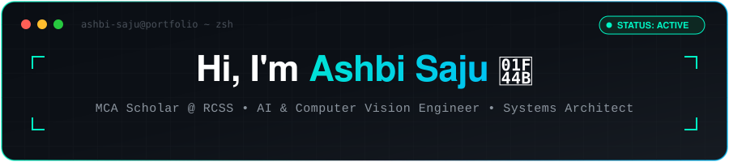

<!-- ============================================================================== -->
<!-- 🚀 ASHBI SAJU | GITHUB PROFILE README                                          -->
<!-- AI / ML & Computer Vision Engineer • Full-Stack Systems Architect • IoT Builder -->
<!-- ============================================================================== -->

  <!-- Self-Hosted High-Resolution Clean Header Banner (Zero External Dependency) -->
  

    

  <!-- Dynamic Animated Typing SVG -->
  

  <!-- Status Badges Row -->
  

    
    
    
    
  

  <!-- Interactive Connect & Metrics Badges -->
  

    
    
    
    
    
  

---

<!-- ============================================================================== -->
<!-- ⚡ ABOUT ME SECTION                                                           -->
<!-- ============================================================================== -->

<table align="center" border="0" cellpadding="0" cellspacing="0" width="100%" style="border: none; border-collapse: collapse; background: transparent;">
  <tr style="border: none; background: transparent;">
    <td width="60%" valign="top" style="border: none; background: transparent; padding-right: 20px;">
      <h3>👨‍💻 &lt;About Me /&gt;</h3>
      

        I am an <b>MCA Scholar</b> at <b>Rajagiri College of Social Sciences (Autonomous)</b> and a graduate in Computer Applications from <b>De Paul Institute of Science & Technology</b>. My engineering identity lies at the intersection of <b>Computer Vision</b>, <b>Deep Learning</b>, <b>Embedded IoT Systems</b>, and <b>Enterprise Full-Stack Platforms</b>.
      

      <ul>
        <li>🎓 <b>Academic Track:</b> Master of Computer Applications (MCA) @ <b>RCSS Kalamassery</b> (2025–2027) | BCA @ <b>DiST</b> (2022–2025).</li>
        <li>🔬 <b>Core Research:</b> Real-time human posture quantification (YOLO11), GenAI synthetic image detection (EfficientNetB0 — 87.11% accuracy on CIFAKE), and edge traffic preemption.</li>
        <li>🛠️ <b>Systems Builder:</b> Architected 14+ end-to-end repositories spanning PyTorch CUDA models, C# .NET / Java desktop suites, Android native apps, and ESP32 hardware relays.</li>
        <li>💡 <b>Engineering Philosophy:</b> <i>"Bridging mathematical machine intelligence with robust, deterministic, and scalable software systems."</i></li>
      </ul>
    </td>
    <td width="40%" align="center" valign="middle" style="border: none; background: transparent;">
      
    </td>
  </tr>
</table>

---

<!-- ============================================================================== -->
<!-- 🛠️ TECHNICAL ARSENAL & SKILLS MATRIX                                          -->
<!-- ============================================================================== -->

  <h3>🛠️ Technical Arsenal & Core Stack</h3>
  
<i>Hover over icons for interactive micro-animations</i>

  
  

 

<table align="center" width="100%">
  <tr>
    <td width="25%" valign="top"><b>💻 Languages</b></td>
    <td>
      
      
      
      
      
      
      
      
      
      
    </td>
  </tr>
  <tr>
    <td width="25%" valign="top"><b>🧠 AI, ML & Vision</b></td>
    <td>
      
      
      
      
      
      
      
      
      
      
    </td>
  </tr>
  <tr>
    <td width="25%" valign="top"><b>🌐 Frameworks & Apps</b></td>
    <td>
      
      
      
      
      
      
      
    </td>
  </tr>
  <tr>
    <td width="25%" valign="top"><b>🗄️ Databases & Hardware</b></td>
    <td>
      
      
      
      
      
      
      
    </td>
  </tr>
  <tr>
    <td width="25%" valign="top"><b>⚙️ DevOps & Tooling</b></td>
    <td>
      
      
      
      
      
      
    </td>
  </tr>
</table>

---

<!-- ============================================================================== -->
<!-- 🚀 FEATURED SYSTEMS & RESEARCH SHOWCASE                                       -->
<!-- ============================================================================== -->

### 🌟 Featured Systems & Research Showcase

#### 🧠 Artificial Intelligence, Deep Learning & Computer Vision

<table width="100%">
  <tr>
    <td width="32%">
      <b><a href="https://github.com/aashbiii/Classroom-Engagement-Detection-YOLO">Classroom-Engagement-Detection-YOLO</a></b> 
      
      
    </td>
    <td>
      <b>Real-Time EdTech Posture & Focus Quantification</b> 
      Fine-tuned Ultralytics YOLO11 model detecting multi-student classroom behaviors (hand-raising, reading, writing, phone usage) to synthesize a real-time, weighted engagement index (0–100%) with an interactive Gradio analytics dashboard.
      

        
<b>🔍 Technical Architecture & Specs</b>

        <ul>
          <li><b>Backbone:</b> Ultralytics YOLO11n fine-tuned on multi-class educational posture datasets with PyTorch CUDA 12.4 acceleration.</li>
          <li><b>Engagement Index:</b> Composite formula: $Score = \frac{1}{N}\sum (w_i \cdot Conf_i)$ weighing active participation against distraction triggers.</li>
          <li><b>Interface:</b> Dual-mode input (live webcam stream & video file batch processing) with real-time bounding box metrics.</li>
        </ul>
      

    </td>
  </tr>
  <tr>
    <td width="32%">
      <b><a href="https://github.com/aashbiii/Fake-vs-Real-Image-Detection">Fake-vs-Real-Image-Detection</a></b> 
      
      
    </td>
    <td>
      <b>GenAI Synthetic vs Real Authenticity Detection</b> 
      Two-phase Transfer Learning architecture classifying generative AI imagery (Stable Diffusion 1.4) against real photography on 120,000 CIFAKE images, achieving <b>87.11% test accuracy</b> with Grad-CAM visual interpretability.
      

        
<b>🔍 Technical Architecture & Specs</b>

        <ul>
          <li><b>Phase 1:</b> Frozen ImageNet feature extractor with custom Dense-Dropout classification head.</li>
          <li><b>Phase 2:</b> Differential fine-tuning of top 30 convolutional blocks using Adam optimizer ($\eta = 10^{-4}$).</li>
          <li><b>Interpretability:</b> Grad-CAM heatmaps identifying latent diffusion artifacts around micro-textures and high-frequency edges.</li>
        </ul>
      

    </td>
  </tr>
  <tr>
    <td width="32%">
      <b><a href="https://github.com/aashbiii/AI-Traffic-Controller-Emergency-Preemption">AI-Traffic-Controller-Emergency-Preemption</a></b> 
      
      
    </td>
    <td>
      <b>Adaptive Traffic Signal & Priority Vehicle Preemption</b> 
      Edge computer vision platform measuring intersection vehicle densities via YOLOv5, dynamically optimizing green-light phases, detecting emergency sirens/vehicles for immediate priority green preemption, and actuating physical Arduino relays.
      

        
<b>🔍 Technical Architecture & Specs</b>

        <ul>
          <li><b>Vision Engine:</b> YOLOv5s real-time object tracking calculating per-lane congestion coefficients.</li>
          <li><b>Actuation:</b> Bi-directional serial communication protocol driving physical Arduino 4-way traffic LED arrays.</li>
          <li><b>Ecosystem:</b> Desktop monitoring GUI built in PyQt5 with companion Android Kotlin telemetry app.</li>
        </ul>
      

    </td>
  </tr>
  <tr>
    <td width="32%">
      <b><a href="https://github.com/aashbiii/Campus-Placement-Prediction-ML">Campus-Placement-Prediction-ML</a></b> 
      
      
    </td>
    <td>
      <b>Dual-Objective Academic Analytics Pipeline</b> 
      Integrated predictive ML pipeline evaluating 3,000 student academic profiles to simultaneously classify placement eligibility and regress predicted CTC salary packages (in LPA) utilizing ensemble Random Forest and XGBoost regressors.
      

        
<b>🔍 Technical Architecture & Specs</b>

        <ul>
          <li><b>Classification:</b> Evaluates academic CGPA, backlogs, technical aptitude, and internship counts.</li>
          <li><b>Regression:</b> Multi-feature gradient boosted regression predicting compensation packages with cross-validated $R^2$ scoring.</li>
        </ul>
      

    </td>
  </tr>
</table>

#### ⚡ IoT, Smart Grid & Embedded Hardware

<table width="100%">
  <tr>
    <td width="32%">
      <b><a href="https://github.com/aashbiii/Campus-Microgrid-IoT-Optimization">Campus-Microgrid-IoT-Optimization</a></b> 
      
      
    </td>
    <td>
      <b>Campus Micro-Grid & Energy Optimization System (CM-EOS)</b> 
      Smart energy telemetry network capturing ESP32 voltage/current sensor telemetry over MQTT, enforcing automated 30-second idle relay actuation cutoffs, and forecasting campus 6-hour power demand with Gradient Boosting Regressors.
      

        
<b>🔍 Technical Architecture & Specs</b>

        <ul>
          <li><b>Hardware Simulation:</b> Dual ESP32 firmware running FreeRTOS with sub-second MQTT publisher loop.</li>
          <li><b>Cloud Telemetry:</b> HiveMQ broker bridging hardware messages to Python ingest pipelines.</li>
          <li><b>Analytics:</b> Streamlit interactive dashboard with automated relay trip logic and persistent SQLite logging.</li>
        </ul>
      

    </td>
  </tr>
</table>

#### 🏢 Enterprise Desktop & Institutional Platforms

<table width="100%">
  <tr>
    <td width="32%">
      <b><a href="https://github.com/aashbiii/MentorSpace">MentorSpace</a></b> 
      
      
      
    </td>
    <td>
      <b>Institutional Mentor-Mentee Intelligence Platform</b> 
      Enterprise 8-role academic mentorship platform engineered for Rajagiri College (RCSS), integrating local on-premise LLMs (Ollama Llama 3.2 3B) for confidential student profile synthesis, WHO-5 Wellbeing indexing, and cryptographic PDF digital signing.
      

        
<b>🔍 Technical Architecture & Specs</b>

        <ul>
          <li><b>Privacy-First AI:</b> 100% on-premise local inference eliminating data leakage of sensitive counseling records.</li>
          <li><b>Role-Based Access:</b> Strict RBAC across 8 hierarchy tiers (Student, Faculty Mentor, HOD, Dean, Principal, Counselor).</li>
          <li><b>Cryptographic Signing:</b> Native pyHanko digital certificate injection producing immutable, verified PDF meeting minutes.</li>
        </ul>
      

    </td>
  </tr>
  <tr>
    <td width="32%">
      <b><a href="https://github.com/aashbiii/Networked-Exam-Engine">Networked-Exam-Engine</a></b> 
      
      
    </td>
    <td>
      <b>Cryptographic Desktop Assessment Engine</b> 
      Robust enterprise desktop assessment platform featuring SHA-256 hashed credential authentication, tamper-resistant countdown session timers with auto-submit guarantees, and question-by-question performance scorecards.
      

        
<b>🔍 Technical Architecture & Specs</b>

        <ul>
          <li><b>Persistence:</b> Microsoft SQL Server 2022 with parameterized ADO.NET commands preventing SQL injection.</li>
          <li><b>Integrity:</b> Client-side event hook preventing application switching and session termination during live tests.</li>
        </ul>
      

    </td>
  </tr>
  <tr>
    <td width="32%">
      <b><a href="https://github.com/aashbiii/ECommerceSystem">ECommerceSystem</a></b> 
      
      
    </td>
    <td>
      <b>Enterprise Shopping & Inventory Management Suite</b> 
      Full-scale desktop enterprise application connecting to Oracle Database 21c XE via JDBC, featuring transactional shopping carts, stock replenishment triggers, order lifecycle management, and a complete technical specification PDF.
      

        
<b>🔍 Technical Architecture & Specs</b>

        <ul>
          <li><b>Database Architecture:</b> Oracle 21c schema with relational foreign-key integrity and sequence-driven primary keys.</li>
          <li><b>UI Presentation:</b> Java Swing custom styling using modern Nimbus Look & Feel.</li>
        </ul>
      

    </td>
  </tr>
</table>

#### 📱 Mobile, Web & Interactive Algorithmic Systems

<table width="100%">
  <tr>
    <td width="32%">
      <b><a href="https://github.com/aashbiii/HallBookingSystem">HallBookingSystem</a></b> 
      
      
    </td>
    <td>
      <b>RCSS Venue & Seminar Hall Reservation App</b> 
      Native Android mobile app resolving campus venue scheduling conflicts with automated slot validation, admin approval queues, date-range collision prevention, and instant reservation vouchers.
    </td>
  </tr>
  <tr>
    <td width="32%">
      <b><a href="https://github.com/aashbiii/lpp-graphical-solver">lpp-graphical-solver</a></b> 
      
      
    </td>
    <td>
      <b>Linear Programming Graphical Corner Point Solver</b> 
      Mathematical optimization engine solving two-variable LPP models by plotting constraint inequalities, identifying bounded/unbounded feasible polygons, and computing exact corner-point extrema in both Python and HTML5 Canvas.
    </td>
  </tr>
  <tr>
    <td width="32%">
      <b><a href="https://github.com/aashbiii/photobooking">photobooking</a></b> 
      
      
    </td>
    <td>
      <b>KuttyStories Kerala Photographer Platform</b> 
      Full-stack photography business platform adhering strictly to Python DB-API 2.0 standards without external ORMs, featuring customer session booking, portfolio filtering, and an administrative order manager.
    </td>
  </tr>
  <tr>
    <td width="32%">
      <b><a href="https://github.com/aashbiii/Portfolio">Portfolio</a></b> 
      
      
    </td>
    <td>
      <b>Interactive Cloud Developer Portfolio</b> 
      Modern developer portfolio engineered with dynamic cursor glow animations, interactive skill meters, responsive glassmorphism aesthetic, and serverless deployment on Vercel.
    </td>
  </tr>
  <tr>
    <td width="32%">
      <b><a href="https://github.com/aashbiii/Online-Shopping-Website">Online-Shopping-Website</a></b> 
      
      
    </td>
    <td>
      <b>OnShopee Modern Client-Side E-Commerce</b> 
      Responsive neon-themed client-side shopping storefront featuring live multi-category product filtering, persistent LocalStorage cart state, coupon calculators, and checkout modals.
    </td>
  </tr>
  <tr>
    <td width="32%">
      <b><a href="https://github.com/aashbiii/Sudoko-Game">Sudoko-Game</a></b> 
      
      
    </td>
    <td>
      <b>Algorithmic Sudoku Solver & Interactive Board</b> 
      Interactive puzzle game demonstrating recursive depth-first search backtracking algorithms with real-time constraint validation and dynamic difficulty generators.
    </td>
  </tr>
</table>

---

<!-- ============================================================================== -->
<!-- 📊 GITHUB ANALYTICS & ACTIVITY MATRIX                                         -->
<!-- ============================================================================== -->

  <h3>📊 GitHub Analytics & Activity Matrix</h3>
   

  <!-- Animated Contribution Grid Snake (Dual-Mode: Dark & Light) -->
  

    
    
  

   

  <!-- Streak Stats Card (Animated Flame) -->
  

    
  

   

  <!-- GitHub Stats & Top Languages Side-by-Side (Clean Paragraph Formatting) -->
  

    
    
  

   

  <!-- Dynamic Rotating Tech Quote -->
  

    
  

---

<!-- ============================================================================== -->
<!-- 📫 CONNECT WITH ME                                                            -->
<!-- ============================================================================== -->

  <h3>📫 Let's Connect & Build Together</h3>
  

    Whether you want to discuss <b>Computer Vision research</b>, <b>AI system engineering</b>, <b>open-source collaborations</b>, or prospective engineering opportunities — my inbox is always open!
  

  

    
    &nbsp;&nbsp;
    
    &nbsp;&nbsp;
    
    &nbsp;&nbsp;
    
  

   

  Crafted with passion, precision & code by <b>Ashbi Saju</b> • Kochi, Kerala, India 🇮🇳

